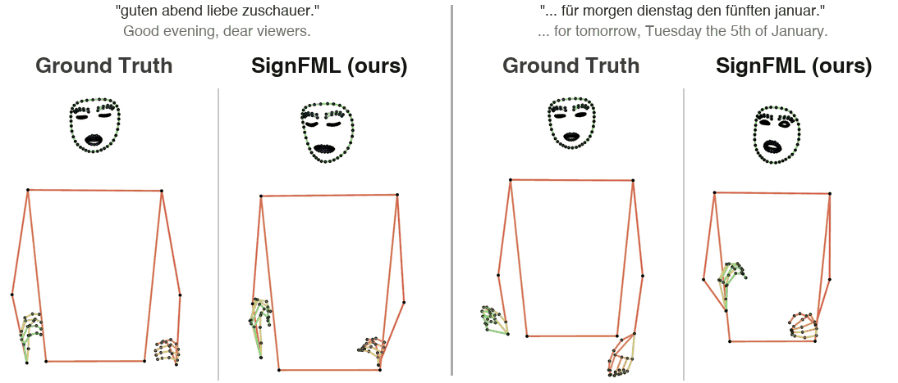
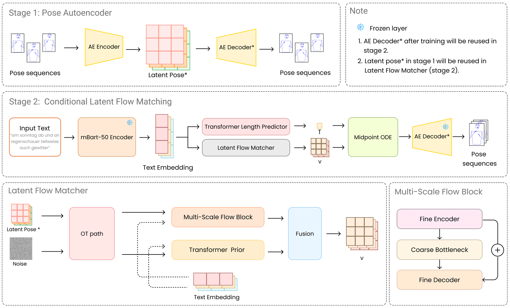
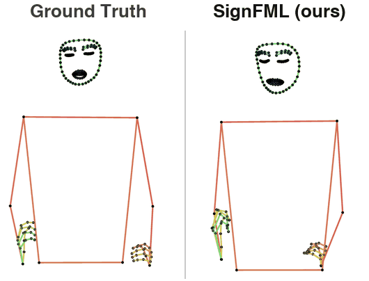
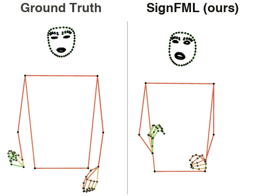
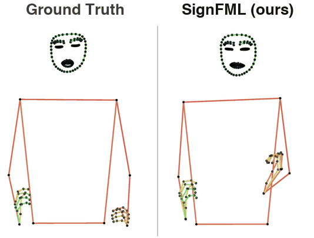
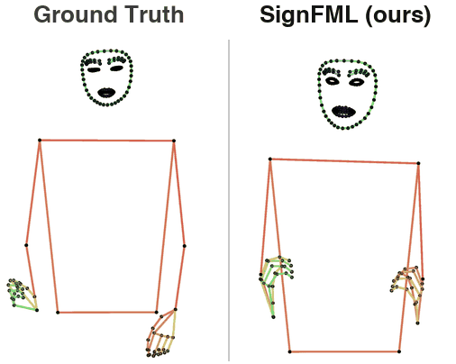
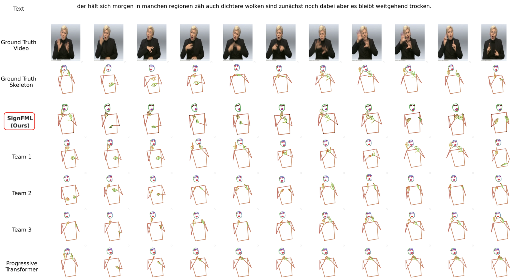

<div align="center">


<h1>SignFML: Gloss-Free Sign Language Production<br>via Multi-Scale Latent Flow Matching</h1>

**Kieu T. T. Vo**<sup>1</sup> · **Tho T. Quan**<sup>1&dagger;</sup>

<sup>1</sup>Faculty of Computer Science and Engineering, Ho Chi Minh City University of Technology (HCMUT), VNU-HCM, Vietnam
<br>
&dagger;Corresponding author

**BMVC 2026**

<a href="https://bmvc2026.bmva.org/programme/accepted_papers/"></a>
<a href="https://thanhkieuvt.github.io/signfml-demo/"></a>
<a href="#checkpoints"></a>

<a href="LICENSE"></a>



<sub>Generated from German text only, on PHOENIX-2014T test sentences. In each pair, left is the ground-truth skeleton and right is SignFML.</sub>

</div>

SignFML turns spoken-language text into 3D sign pose sequences without gloss annotation. It runs conditional flow matching in the compact latent space of a pose autoencoder, so training stays stable on a small dataset and sampling needs about 10&times; fewer network evaluations than diffusion models.
 

## Highlights

- **Latent flow matching.** Generation happens in a 256-D latent space learned by a frozen pose autoencoder, not on raw 534-D poses.
- **Coarse-to-fine velocity.** A Transformer prior predicts the global direction early in sampling, and a multi-scale flow block refines local articulation.
- **SLT perceptual loss.** A frozen sign-to-text encoder compares generated and real poses at the sentence level, which keeps the meaning of the input.
- **Strong and fast.** Best BLEU-4 (12.58) and WER (81.51) on PHOENIX-2014T among the compared systems, with 100 NFEs per sample.

## Method

<p align="center"></p>

SignFML works in two stages: a pose autoencoder learns a compact latent space for signing motion, and a text-conditioned flow matching model generates in that space. The coarse-to-fine velocity decomposition, the SLT perceptual loss and the full training and sampling details are described in the paper.

## Results

PHOENIX-2014T test set, SLRTP 2025 evaluation protocol. Text metrics come from back-translating the generated poses. *Dist* is total wrist travel relative to the real signer, so values closer to 1 are better.

| Method | Gloss | BLEU-4 &uarr; | ROUGE &uarr; | WER &darr; | DTW-MJE &darr; | Dist &rarr; 1 |
|:--|:--:|:--:|:--:|:--:|:--:|:--:|
| Ground Truth | | 12.78 | 35.20 | 85.77 | 0.0000 | 1.000 |
| Progressive Transformer | ✗ | 5.43 | 21.98 | 101.45 | 0.0418 | 0.257 |
| SLRTP 2025 Team 3 (Hacettepe) | ✗ | 9.59 | 30.64 | 88.88 | 0.0423 | 0.798 |
| SLRTP 2025 Team 1 (USTC-MoE) | ✓ | 12.06 | 36.59 | 93.49 | 0.0448 | 1.631 |
| DARSLP-KL | ✗ | 10.90 | 31.80 | | 0.0390 | |
| ILRSLP-KL | ✗ | 11.37 | 34.10 | | **0.0370** | |
| **SignFML (ours)** | ✗ | **12.58** | **36.65** | **81.51** | 0.0434 | **0.886** |

<details>
<summary><b>Ablation and evaluator robustness</b></summary>
<br>

| Setting | BLEU-4 &uarr; | WER &darr; |
|:--|:--:|:--:|
| **SignFML (full)** | **12.58** | **81.51** |
| w/o SLT loss | 6.89 | 94.81 |
| w/o latent space (raw pose) | 9.00 | 90.54 |
| w/o multi-scale | 10.00 | 91.55 |
| w/o coarse-to-fine prior | 10.83 | 84.20 |

The SLT loss and the standard back-translation evaluator share a checkpoint, so we also score SignFML with two separately trained evaluators:

| Evaluator | BLEU-4 &uarr; | WER &darr; |
|:--|:--:|:--:|
| SLT<sub>orig</sub> (SLRTP standard) | 12.58 | 81.51 |
| SLT<sub>ind</sub> (Transformer, new seed) | 12.96 | 80.64 |
| SLT<sub>rnn</sub> (BiLSTM) | 12.42 | 82.85 |

</details>

## Qualitative examples

<table>
<tr>
<td width="50%"><br><i>"guten abend liebe zuschauer."</i><br>Good evening, dear viewers.</td>
<td width="50%"><br><i>"und nun die wettervorhersage für morgen dienstag den fünften januar."</i><br>And now the weather forecast for tomorrow, Tuesday the 5th of January.</td>
</tr>
<tr>
<td width="50%"><br><i>"und nun die wettervorhersage für morgen donnerstag den dritten märz."</i><br>And now the weather forecast for tomorrow, Thursday the 3rd of March.</td>
<td width="50%"><br><i>"und nun die wettervorhersage für morgen montag den achtundzwanzigsten november."</i><br>And now the weather forecast for tomorrow, Monday the 28th of November.</td>
</tr>
</table>

Comparison with the SLRTP 2025 challenge entries on the same sentence. Progressive Transformer and Team 3 keep the arms close to the body and Team 2 jitters.

<p align="center"></p>

## Checkpoints

Pretrained weights are hosted on Google Drive, as the files are too large for Git or GitHub Releases.

| Stage | Description | Download |
|:--|:--|:--:|
| Stage 1 | Pose autoencoder (frozen in Stage 2) | [Google Drive](https://drive.google.com/drive/folders/1FibopW3Nk3E0w-tkShI3FFlrdllAQ3N9?usp=drive_link) |
| Stage 2 | SignFML final (BLEU-4 12.58, WER 81.51) | [Google Drive](https://drive.google.com/drive/folders/15QJoVisL7GyP4WxtIh42wsRITm3swosI?usp=drive_link) |

## Code overview

> [!NOTE]
> This is a public reference release accompanying the paper. The model and training code are provided as **skeletons** (class and method structure only) with implementation details, hyperparameters and data pipelines redacted. It documents the method and architecture and is not meant for re-execution.

<details>
<summary><b>Repository layout</b></summary>

```
SignFML-BMVC2026/
├── training/
│   ├── train_stage1_autoencoder.py     # Stage 1: pose autoencoder
│   └── train_stage2.py                 # Stage 2: latent flow matching
├── models/fml/                         # core models (skeletons)
│   ├── autoencoder.py
│   ├── autoencoder_v2.py
│   ├── latent_flow_matcher.py
│   ├── transformer_prior.py
│   ├── flow_matching.py
│   ├── weighted_pose_loss.py
│   ├── slt_perceptual_loss.py
│   └── ema.py
├── tools/slt_wrapper.py                # wrapper around the frozen back-translation SLT
├── configs/
└── requirements.txt
```

</details>

## Contact

For questions or research collaboration, please contact Kieu Vo at [vothithanhkieu400@gmail.com](mailto:vothithanhkieu400@gmail.com).

## Citation

If you find SignFML useful, please cite:

```bibtex
@inproceedings{vo2026signfml,
  title     = {SignFML: Gloss-Free Sign Language Production via Multi-Scale Latent Flow Matching},
  author    = {Vo, Kieu and Quan, Tho},
  booktitle = {British Machine Vision Conference (BMVC)},
  year      = {2026}
}
```

## Acknowledgements

We acknowledge Ho Chi Minh City University of Technology (HCMUT), VNU-HCM for supporting this study. We evaluate with the SLRTP 2025 protocol on RWTH-PHOENIX-Weather-2014T and use mBART-50 as the text encoder.

## License

Released under the [MIT License](LICENSE).
